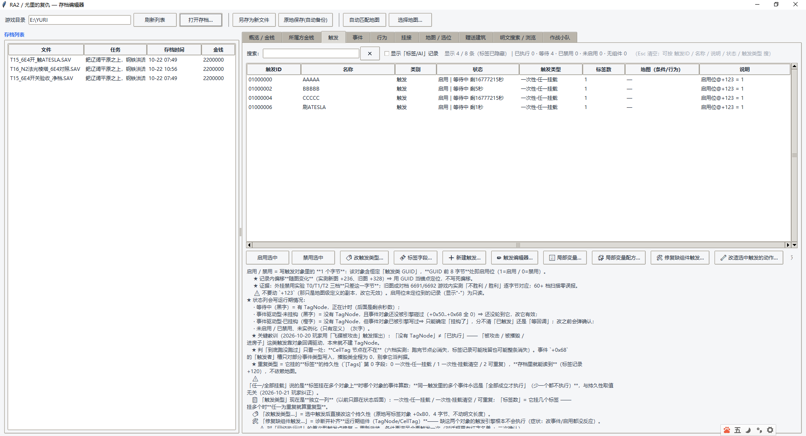
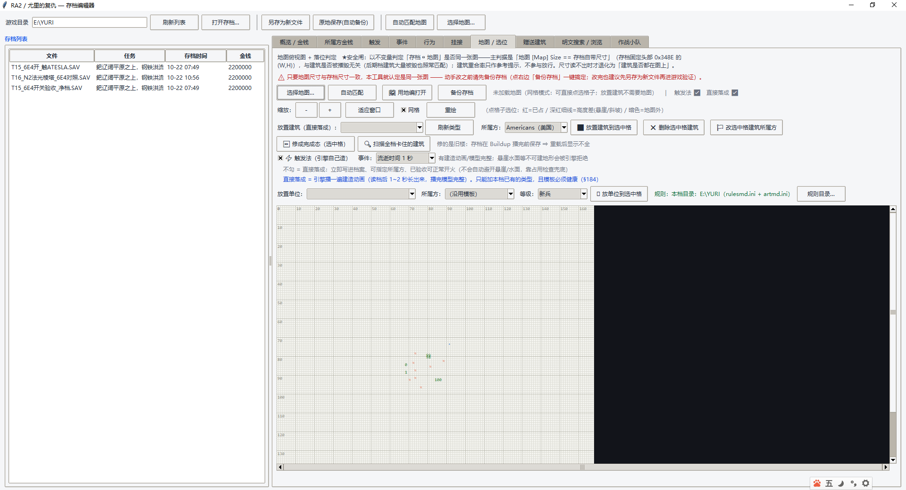

# RA2 / 尤里的复仇 — 存档编辑器

> 图形化修改《命令与征服：红色警戒2 / 尤里的复仇》**任务存档（`.SAV`）**的桌面工具。
> 改金钱、改所属方、改触发器和它的「事件 / 行为」、放建筑、放单位、改作战小队……
> 目标是**像地编（FinalAlert 2）一样直观**地改存档，而且不用进游戏编辑器重做整张图。

- 平台：Windows（Python + tkinter，纯标准库，**不需要装任何第三方库**）
- 语言：界面与文档为中文
- 许可：**MIT**（见 [LICENSE](LICENSE)；游戏素材声明见 [NOTICE.md](NOTICE.md)）
- 当前版本：**v1.0.6**（内部构建 `p160`）
- **下载**：https://github.com/zhonglijiezhao/RA2-Save-Editor/releases/latest

---

## 1. 先看清楚：这个工具**不包含**什么

| 不包含 | 说明 |
|---|---|
| 游戏本体与素材 | 仓库里**没有**任何 `.exe/.dll/.mix/.shp/.vxl/.sav/.map` 游戏文件，需要你自己有正版游戏 |
| 地图内容 | 工具只读写**你自己的存档**；地图（`.MAP`）默认**一个字节都不碰** |

《红色警戒2》《尤里的复仇》及其全部素材版权归 EA / Westwood 所有。本项目只包含**自己写的代码**
和对存档格式的**逆向研究记录**，仅用于单机存档修改与学习交流，请勿用于联机作弊或商业用途。

## 截图

触发页：状态 / **触发类型（持久性）** / 标签字段 / 局部变量配方，一条触发挂的事件行为一目了然。



地图 / 选位页：点格子放建筑，`⚡ 触发法` 与「直接落成」两种模式。



---

## 2. 功能一览（按界面页签）

| 页签 | 能做什么 |
|---|---|
| 概览 / 金钱 | 看存档基本信息（玩家、金钱、明文大小）；改金钱（含 12 个所属方各自的钱） |
| 所属方金钱 | 逐个所属方改钱 |
| **触发** | 触发列表（状态 / 触发类型 / 说明）；启用 / 禁用；**改触发类型（持久性 0/1/2）**；**标签字段窗口**；触发编辑器 |
| 事件 / 行为 | 查看每条触发挂的事件与行为链（类型、参数、参数含义、所属触发） |
| 挂接 | 查看触发挂在哪些建筑 / 单位上；修「缺组件」的触发（补 TagNode / CellTag / 计时表） |
| 地图 / 选位 | 在地图上点格子放建筑（触发法 / 直接落成两种模式）；路径点管理 |
| 赠送建筑 | 给指定所属方加建筑 |
| 明文搜索 / 浏览 | 全明文搜索、十六进制浏览（定位陌数字段用） |
| 作战小队 | FA2 的三个对话框：作战小队 / 特遣部队 / 动作脚本（等级、国家、出现于、预装载、成员表） |

命令行另有一套只读/批处理开关，见 `RA2存档编辑器.exe --help` 或直接运行 `app_main.py` 看头部注释。

---

## 3. 怎么用（新手路线）

### 3.1 直接用打包好的 exe（不需要 Python）

1. 到 [Releases](https://github.com/zhonglijiezhao/RA2-Save-Editor/releases/latest) 下载 `RA2-Save-Editor-v1.0.6.zip`
2. 解压到**任意**目录（不要只解压出 exe —— 必须连 `_internal` 文件夹一起解压）
3. 双击 `RA2存档编辑器.exe`
4. **先备份存档**：把 `C:\Users\你\AppData\...` 或游戏目录 `save\` 里的 `.SAV` 复制一份
5. 打开存档 → 改 → 用界面上的保存按钮另存为新文件 → 把新文件放回游戏存档目录

> exe 是 PyInstaller 打的窗口程序，没有控制台。启动失败会在 exe 同目录写 `启动错误.txt`。

### 3.2 从源码跑（改代码/学习用）

```bash
# 只需要 Python 3.9+（自带 tkinter 即可，无第三方依赖）
python "RA2存档编辑器.py"
```

Windows 上如果双击 `.py` 一闪就过，用命令行跑一次看报错：

```bash
python "RA2存档编辑器.py"
```

也可以先用 `启动(调试).bat`（前台模式，报错留在窗口里）。

### 3.3 自检（确认这份代码在你机器上是好的）

```bash
# 需要一个你自己的 .SAV 存档作为样本
"RA2存档编辑器.exe" --selftest 你的存档.SAV
# 结果写在 exe 旁边的 自检结果.txt，最后一行是 SELFTEST PASS 就正常
```

---

## 4. ★ 用之前必须知道的四件事（全是踩出来的）

1. **改完不弹保存框，工具不会自动替你存盘。** 界面只改内存，状态栏出现「（尚未保存）」，
   保存是你自己的动作 —— 这是故意的，避免误改覆盖原档。
2. **工具绝不默认改你的 `.MAP`。** 只有你显式点「写地图」才会动，并且会同步重算地图的
   `[Digest]` 校验（否则进游戏会提示「地图被人修改」）。
3. **新写触发要「挂心跳」。** 想用「局部变量值」当条件（事件 36/37）时，事件列表里必须有一条
   「13 流逝时间」并且放在**第一位**，否则这条触发永远不评估（工具里一切正常、进游戏就是没反应）。
   用界面上的「🧩 局部变量配方…」会自动加，别自己拼。
4. **持久性（触发类型）只有 0 是多年实测稳定的。** 1 / 2 有已知引擎坑（含局部变量事件的触发写 1 = 永不触发），
   改动前请先看界面里的红字说明。

---

## 5. 目录结构

```
RA2存档编辑器.py       GUI 主程序（tkinter）
app_main.py            CLI 入口（也是 PyInstaller 的入口；--selftest 走这里）
launcher.py            启动器（.bat 转接，处理启动报错）
map_view.py            地图渲染 / 选格
core/
  editor_core.py       引擎级核心：存档解码、触发六件套、建筑/单位、局部变量……
  cfb.py cfb_write.py  CFB（复合文档）读写
  lzo1x.py lzo_compress.py lzo_fast.*   LZO 解压/压缩（lzo_fast 是自家 C 实现的加速版）
  ai_objects.py        作战小队三大件
  game_ini.py map_ini.py fa2_tables.py 规则与地图 INI
  type_signature.json  建筑/单位的字段指纹（模板健康度检查用）
  ini_builtin/ unit_comp_lib/  内置查表数据
docs/
  加建筑_所属方_20261017.md   ★主设计文档（190+ 节，存档格式逆向全过程，含全部实测结论）
  其它                   现场笔记 / 历史交接档
_selftest_*.py         自检脚本（49 个，覆盖触发、局部变量、AI、单位、标签字段……）
```

## 6. 开发 / 打包

```bash
# 自检（示例）
python _selftest_ev192.py
python _selftest_unit_place.py

# 打包（需要 pip install pyinstaller）
cd build_work
python -m PyInstaller --distpath ../build_dist_pNN RA2存档编辑器.spec
```

打包注意：`RA2存档编辑器.spec` 里用 `SPECPATH` 计算绝对路径，**不要**写 `'..\core'`
（那是按当前工作目录解析的，会打出「启动即 ModuleNotFoundError」的坏 exe）。

贡献方式见 [CONTRIBUTING.md](CONTRIBUTING.md)，接下来要做什么见 [docs/路线图.md](docs/路线图.md)，
想把项目发布到 GitHub 的步骤见 [docs/开源发布指南.md](docs/开源发布指南.md)。

---

## 7. 常见问题

| 现象 | 原因 / 处理 |
|---|---|
| 进游戏读档弹 `Internal error` | 存档里某个引用到了运行时才崩。先回滚备份；抓崩溃现场的脚本见 `docs/` 与技能里的 crash probe |
| 工具里改了触发，进游戏没反应 | 先查 §4.3 的心跳；再确认持久性是 0；再确认变量号是「引擎索引」（地编里第 N 条 = 索引 N−1） |
| 加了建筑显示不全 | 别跨类型直接落成；本档没有该类型时用「⚡ 触发法」 |
| 游戏提示「地图被人修改」 | 地图 `[Digest]` 没重算。用工具的写地图按钮走正常流程即可 |

---

## 8. 致谢与参考

存档格式（CFB / LZO / 触发六件套 / 各类对象字段）全部靠本机实测 + 反汇编确认，
判据优先级：**本机实测 > 本机硬证据（反汇编 / 逐字节 diff）> ModEnc > 论坛帖子**。
感谢 ModEnc、Project Perfect Mod、FinalAlert 2 社区多年积累的格式资料。
